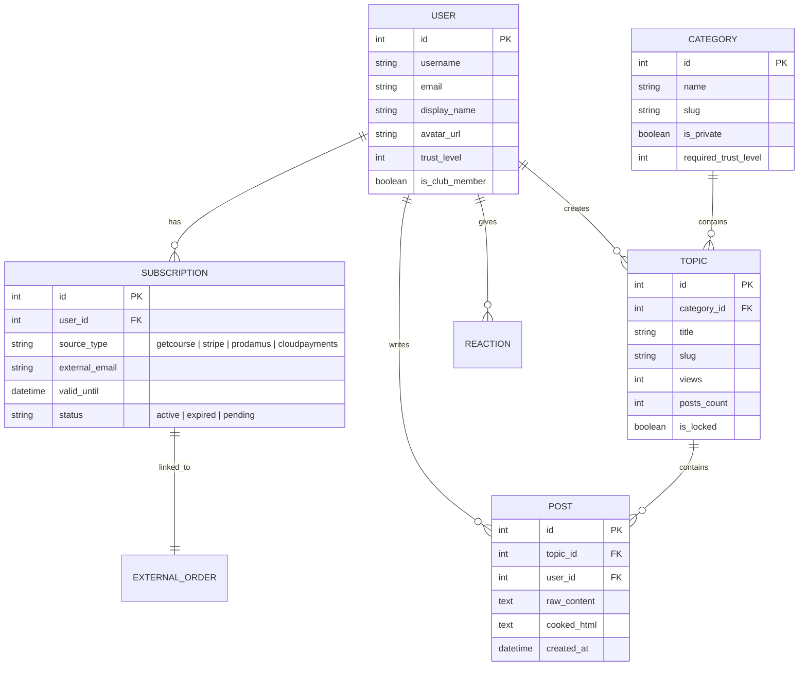

# Архитектура и спецификация API для клонирования платформы

## 1. Схема данных (Data Model)

---

## 2. Основные REST API эндпоинты

### Публичные / Ознакомительные:
- `GET /api/site.json` — метаданные платформы, доступные типы уведомлений, базовые настройки.
- `GET /api/categories.json` — список категорий (фильтруется в зависимости от статуса подписки пользователя).
- `GET /api/latest.json` — список последних доступных тем с авторами, счетчиками просмотров и ответов.
- `GET /api/t/{id}.json` — поток постов выбранной темы (для платных тем — проверка токена сессии и валидности подписки).

### Личный кабинет и подписка (`club_access`):
- `GET /api/club/account` — статус подписки текущего пользователя, дата окончания, привязанный аккаунт школы/платежки.
- `POST /api/club/verify-email` — отправка проверочного кода на email покупки при несовпадении с email аккаунта.
- `POST /api/club/confirm-code` — подтверждение кода и мгновенная активация доступа к клубу.
- `POST /api/webhooks/payment` — входящий вебхук от платежной системы (Prodamus / GetCourse / CloudPayments / ЮKassa) для автопродления или закрытия доступа при отмене подписки.

### Интерактив и сообщество:
- `POST /api/posts` — создание поста / ответа в тему.
- `POST /api/post_actions` — добавление реакции (лайк, огонь, спасибо и т.д.).
- `GET /api/chat/channels` — список доступных чат-комнат клуба.
- `WS /api/chat/ws` — WebSocket-канал реального времени для сообщений и статусов присутствия.

